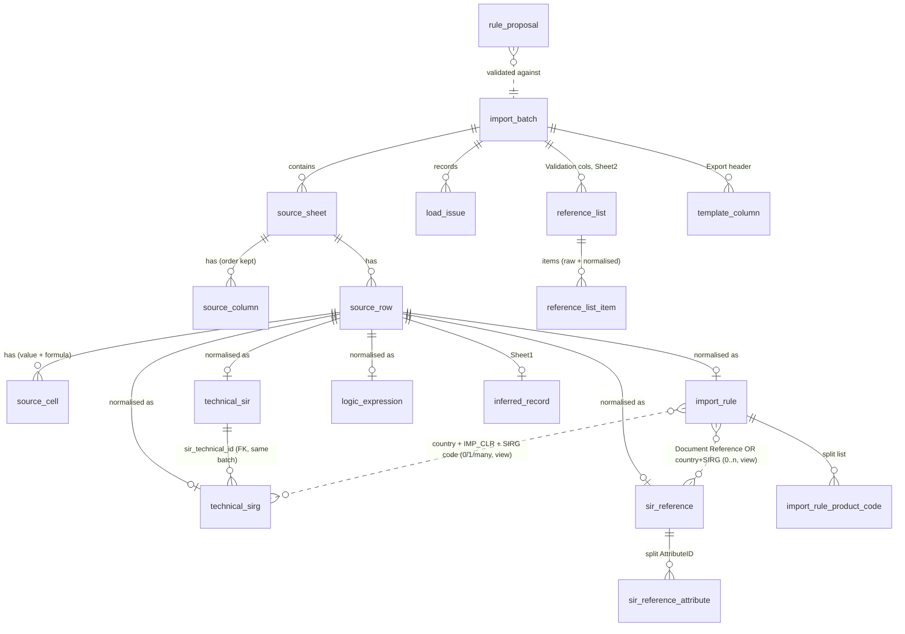
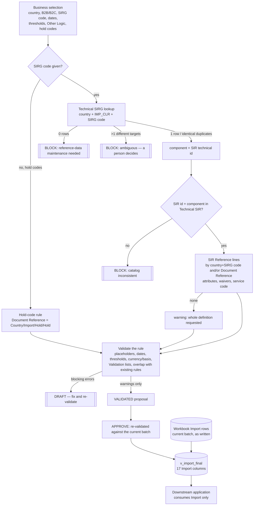

# Phase 2–4 — Database design, source-to-target mapping and resolution flow

Target: **PostgreSQL 16**, schema `sirdb`.
- Migrations: `migrations/sirdb/0001…0005`
- Loader: `tools/sirdb/loader.py`
- Resolution: `tools/sirdb/resolve.py`

The downstream application reads **only `sirdb.v_import_final`**: the 17 Import columns, in Import order and with the Import headers.

## 1. Layers

```
 workbook file ──► import_batch (file hash, status, is_current)
                      │
                      ├─► RAW  source_sheet · source_column · source_row · source_cell     (every cell, value + formula)
                      │
                      ├─► NORMALISED, each row → (batch_id, source_sheet, source_row_no)
                      │     technical_sir · technical_sirg · logic_expression · reference_list(_item)
                      │     template_column · inferred_record · import_rule(_product_code) · sir_reference(_attribute)
                      │
                      ├─► load_issue (findings by sheet/row/column)       change_log (every change, with actor)
                      │
                      └─► VIEWS  v_import_rule_sirg · v_import_rule_sir_reference · v_import_final
                                       ▲
                       rule_proposal ──┘  (authored rules, validated, APPROVED → in v_import_final)
```

## 2. ER diagram



**Cardinalities (verified on the data):**
- Import rule → Technical SIRG: 0..1. The only 2-match is the exact duplicate AU·GSTE.
- Import rule → SIR Reference: 0..n. MX IRID has 4 lines.
- Technical SIRG → Technical SIR: n..1. One component is reused across countries.
- SIR Reference → attributes: 0..n. One cell holds `&&`-joined IDs.

**Keys:**
- `technical_sir (batch_id, sir_technical_id)`: unique, verified. **No uniqueness on CmptNm**: 44 names repeat.
- `technical_sirg (batch_id, source_row_no)` is the key. The lookup key (country, processing type, SIRG code) is **indexed, not unique**, because of the AU·GSTE duplicate record.
- `technical_sirg → technical_sir` is a **real foreign key**: 0 exceptions in the data.
- Import → SIRG and Import → SIR Reference are **views, not FKs**. Placeholders (`TEST`) and legacy hold-code rows would break a strict FK, so the links are evaluated and reported, not enforced.

## 3. Source-to-target mapping — every Import column

| Import column | `import_rule` column(s) | Normalisation (source kept) | `v_import_final` output |
|---|---|---|---|
| Region | `region` | none | as written |
| Country | `country` | none | as written |
| B2B/B2C | `shipment_type` | none (C2C kept) | as written |
| Effective Date (DD-MM-YYY) | `effective_date_raw` · `effective_date` · `effective_date_issue` | text DD-MM-YYYY → `date`; failure reason in `_issue` | raw text |
| Date of Expiry (DD-MM-YYY) | `expiry_date_raw` · `expiry_date` · `expiry_date_issue` | same | raw text |
| Network Product Code | `network_product_code_raw` + `import_rule_product_code(position, product_code)` | split on `,`, trimmed, order kept | raw list |
| Declared Value/ Intristic Value | `value_basis` | none | as written |
| Currency | `currency` | none | as written |
| Min Value (>=) | `min_value_raw` · `min_value numeric` | text → numeric | raw |
| Max Value (<=) | `max_value_raw` · `max_value` | same | raw |
| Shipt Weight (kg) (>=) | `min_weight_raw` · `min_weight` | same | raw |
| Shipt Weight (kg) (<=) | `max_weight_raw` · `max_weight` | same | raw |
| Other Logic | `other_logic` | none — **inert text, never executed** | as written |
| Country Hold Code | `country_hold_code` | numbers kept as text (`1`, `3`) | as written |
| Global Hold Code | `global_hold_code` | none | as written |
| Document Reference | `document_reference` · `document_reference_formula` · `document_reference_kind` (FORMULA / LITERAL / EMPTY) · `is_document_ref_placeholder` | formula text kept beside the cached value | cached value |
| SIRG Document Reference | `sirg_document_reference` · `sirg_ref_country` · `sirg_ref_direction` · `sirg_ref_sirg_cd` · `is_sirg_ref_placeholder` | split on `\|` when it has 3 non-placeholder parts | as written |
| *(derived)* | `rule_generation` HOLD_CODE / SIRG / UNCLASSIFIED | from P's formula and Q's form (see 01 §2) | — |

The other sheets map 1:1, column by column:

| Sheet | Target |
|---|---|
| SIR Reference | `sir_reference`. Column I goes to `col_09_unheaded`; AttributeID is split into `sir_reference_attribute` with the column-I entry at the same position when the counts match |
| Technical SIR | `technical_sir` |
| Technical SIRG | `technical_sirg` |
| Other Logic | `logic_expression` |
| Validation (each column) and Sheet2 | `reference_list` + `reference_list_item`, with `value_raw` and `value_normalized` (trimmed) plus the reason |
| Export | `template_column` |
| Sheet1 | `inferred_record` (`inferred_as = technical_sirg`, with the evidence) |

**Proven by test:** the exported final Import is **cell-for-cell identical** to the workbook's Import sheet (57 × 17 cells, 0 differences).

## 4. Flow: business selection → final Import



## 5. Validation rules for a proposed rule

| Blocking error | Warning |
|---|---|
| any field holding a placeholder (`TEST`, `TBD`) | `DUPLICATE_RECORDS` resolution (identical SIRG rows) |
| country not ISO-2 | no SIR Reference line for the SIRG (whole definition requested) |
| neither SIRG code nor hold codes | SIR Reference lines naming another component |
| SIRG `NOT_FOUND` (maintenance needed) or `AMBIGUOUS` | no expiry date |
| SIR id / component not in Technical SIR | value not in a Validation list (lists are not enforced, Q-10) |
| missing or invalid effective date; invalid expiry; expiry before effective | Other Logic present (stored, not evaluated) |
| negative threshold; min above max | product code not used by any Import rule yet |
| value threshold without currency, or without DV/IV | an Import rule already exists for the same country + SIRG + B2B/B2C |

## 6. Batches and re-import policy

- **Same file, same SHA-256:** nothing happens. The batch is returned as `ALREADY_LOADED`.
- **A partial or failed load of that file:** it is deleted and loaded again in one transaction.
- **A different file:** it becomes a **new batch**, and it becomes `is_current` unless `--keep-current` is given.
- **Earlier batches are history.** Every row is still there, so two workbook versions can be compared by `batch_id`.
- **Views and resolvers use the current batch;** resolvers accept an explicit `batch_id`.
- **Source rows and cells are append-only,** enforced by a trigger. Normalised and reference tables log every change to `change_log`, with the actor taken from `SET sirdb.actor`.
